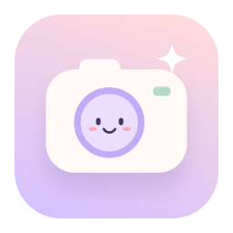
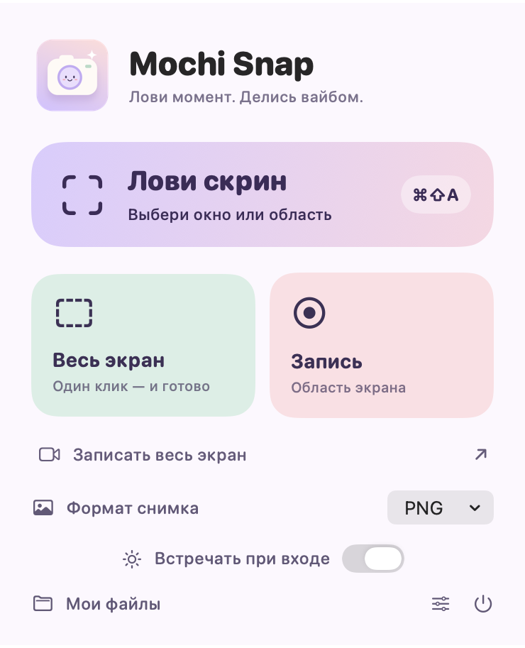
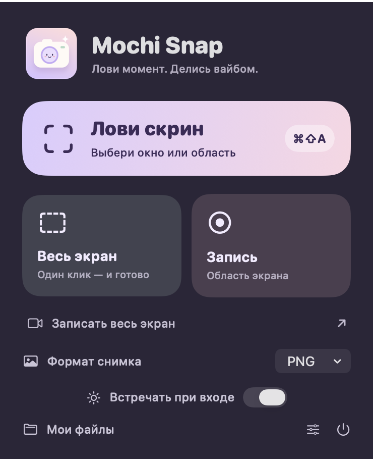

<p></p>

# Mochi Snap

Лови момент. Делись вайбом.

Скриншоты и запись экрана в мягком пастельном интерфейсе. Камера с румянцем живёт в строке меню, инструменты всегда под рукой.

**[↓ Скачать Mochi Snap для macOS](https://github.com/sgsolo/mochi-snap/releases/latest/download/MochiSnap-macOS.zip)**

macOS 15.2 и новее · Apple Silicon и Intel · PNG, JPEG, PDF, MP4

<p>
  
  
</p>

## Начать

1. Распакуй архив и открой **Mochi Snap.app**.
2. Нажми **Перенести и открыть**, чтобы установить приложение в «Программы». Затем нажми на камеру в строке меню.
3. Разреши захват экрана в **Системные настройки → Конфиденциальность и безопасность → Запись экрана и системного звука**.

Сборка подписана локальной подписью. macOS может показать предупреждение при первом запуске.

## Лови скрин

Нажми **⌘⇧A** или выбери **Лови скрин** в меню камеры. Картинка на экране зафиксируется. Выдели нужную область или щёлкни по подсвеченному окну.

- Потяни край или угол рамки, чтобы поправить границы.
- Удерживай **⌥ Option**, чтобы передвинуть рамку целиком.
- Добавь стрелки, линии, фигуры или текст. Карандашом можно рисовать, ластиком — удалять пометки.
- Нажми **Сохранить** или **Enter**. **⌘C** сохранит снимок и скопирует его в буфер обмена. **Esc** отменяет захват.

Справа на пять секунд появится миниатюра. Перетащи её в чат, чтобы прикрепить файл. Щелчок открывает снимок и показывает файл в Finder. Короткое движение вправо скрывает миниатюру.

Если ⌘⇧A уже использует другая программа, меню покажет, что сочетание занято. Захват также доступен через **Лови скрин**.

## Запись экрана

В карточке **Запись** можно выбрать область. Команда **Записать весь экран** сразу запускает запись дисплея под указателем.

Во время записи пространство вокруг выбранной области затемняется. Нажми **Запись идёт**, чтобы остановить и сохранить MP4. Видео записывается без звука. После сохранения появится миниатюра с кадром из записи.

## Всё на своих местах

- Файлы сохраняются в **Изображения → Mochi Snap**. **Мои файлы** открывает эту папку.
- Другая папка выбирается кнопкой с ползунками внизу меню.
- **Формат снимка** переключает PNG, JPEG и PDF. По умолчанию — PNG.
- **Встречать при входе** включает автозапуск. Можно отключить переключателем.
- Правая кнопка мыши по значку камеры открывает стандартное меню команд.

<details>
<summary>Сборка и публикация</summary>

Нужны Xcode 26 или новее и инструменты командной строки.

```sh
./build.sh
```

Универсальное приложение появится в `build/Mochi Snap.app`.

Для подписи Developer ID и нотариализации установи сертификат **Developer ID Application** с закрытым ключом и сохрани профиль `xcrun notarytool store-credentials MochiSnap`.

```sh
MYSCREENSHOT_SIGNING_IDENTITY='Developer ID Application: Name (TEAMID)' \
MYSCREENSHOT_NOTARY_PROFILE=MochiSnap ./release.sh
```

Архив для публикации — `build/MochiSnap-macOS.zip`.

</details>
